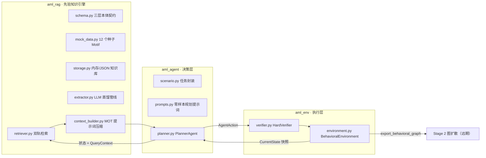

# AML 跨链反洗钱行为图生成框架 · Stage-1（宏观行为决策）

面向**跨链反洗钱行为拓扑生成**的两阶段合成数据框架。本仓库实现其 **Stage-1**：
由 LLM Agent 在"先验知识引擎 → 状态环境 → 规划 Agent"三层闭环中，增量生成
宏观、语义合规、满足 DAG 约束的抽象洗钱行为拓扑图 $G_b$，为 Stage-2 条件图
扩散模型提供条件输入。

**当前状态**：62 个单元测试全部通过；端到端闭环可用（脚本化 LLM 驱动）；
真实 LLM 与真实洗钱数据尚未接入（见《阶段总结与测试计划》）。

## 设计理念

- **零微观数字噪音**：只建模抽象角色、链标签、DAG 层级与抽象操作，彻底剥离
  钱包地址、金额、Gas 费与时间戳；
- **三层本体 Schema**：战术层（`PatternType`）→ 拓扑子图层（`TopologicalMotif`）
  → 关联约束层（`MotifConstraints` / `Preconditions` / `PostStateEffect`），
  全部由 Pydantic v2 在**构造期**强校验（Kahn 判环、level 严格递增、分支度 ≤ $d_{max}$）；
- **双轨检索**：Track-1 硬规则门（前置条件一票否决）+ Track-2 稠密语义打分，
  融合得分 $\text{Score}=\alpha\cdot\cos(\mathbf e_{context},\mathbf e_{motif})
  +(1-\alpha)\cdot\text{RuleSat}$；
- **MOT 提示词压缩**：检索结果经冗余子路径消除后，以 Token 高效 JSON +
  Mermaid DAG 注入规划提示词；
- **零耦合可插拔**：LLM 注入为 `Callable[[str], str]`，Embedding 为 Protocol，
  存储后端无关，无需任何厂商 SDK 即可离线运行与测试。

## 架构（三层闭环）



## 仓库结构

```
src/
├── aml_rag/              # 模块一：先验知识引擎
│   ├── schema.py         #   Pydantic v2 数据契约（角色 / Motif / 状态 / 查询）
│   ├── mock_data.py      #   12 个策展种子 Motif
│   ├── storage.py        #   内存 / JSON / 向量就绪知识库
│   ├── extractor.py      #   LLM 蒸馏提示词与严格解析管线
│   ├── retriever.py      #   双轨检索器（硬门 + 余弦排序）
│   └── context_builder.py#   PromptContextCompressor（JSON + Mermaid DAG）
├── aml_env/              # 模块二：执行层
│   ├── environment.py    #   BehavioralEnvironment 增量 DAG 状态机
│   └── verifier.py       #   HardVerifier 零容忍结构硬门
└── aml_agent/            # 模块三：决策层
    ├── scenario.py       #   ScenarioSpec / ScenarioGoals 任务封装
    ├── prompts.py        #   零样本规划提示词模板
    └── planner.py        #   PlannerAgent 决策循环 + 轨迹审计
demo/
└── showcase_stage1.py    # 阶段性展示产物生成器（见下）
tests/                    # 62 个单元测试（含展示可见性测试）
技术文档/                  # 背景研究、架构设计、阶段总结与测试计划
```

## Quick start

### 1. 只用先验知识引擎（检索 + 压缩）

```python
from aml_rag import (
    build_default_knowledge_base,
    DualTrackMotifRetriever,
    PromptContextCompressor,
    CurrentState,
    QueryContext,
    AbstractNode,
    NodeRole,
)

kb = build_default_knowledge_base()
retriever = DualTrackMotifRetriever(kb, alpha=0.5, top_k=3)

state = CurrentState(
    current_level=2,
    current_chain="Chain_A",
    active_nodes=[AbstractNode(temp_id="AC", role=NodeRole.ASSET_CONVERSION,
                               chain="Chain_A", level=2)],
)
query = QueryContext(
    scenario="launder proceeds of a DeFi exploit",
    tactic_goal="swap to stablecoin then bridge to another chain",
)

results = retriever.retrieve(state, query)
prompt = PromptContextCompressor(output_format="hybrid").build_agent_prompt(
    state, query, results
)
print(prompt)
```

### 2. 三层闭环完整轨迹（脚本化 LLM，离线可复现）

```python
import json

from aml_agent import PlannerAgent, ScenarioGoals, ScenarioSpec
from aml_env import BehavioralEnvironment
from aml_rag import DualTrackMotifRetriever, build_default_knowledge_base
from aml_rag.schema import NodeRole, OperationType


def scripted_llm(replies):
    """确定性 LLM 桩：按序弹出回复。"""
    it = iter(replies)
    def call(prompt: str) -> str:
        return next(it, "not-json")
    return call


def action(op, parents, role=None, chain=None, **params):
    d = {"operation": op}
    if op is not None:
        d.update(parent_ids=parents, target_role=role, target_chain=chain)
        if params:
            d["parameters"] = params
    return json.dumps(d)


replies = [
    action("Transfer", ["node_0"], "Intermediate", "Chain_A"),
    action("Split", ["node_1"], "Intermediate", "Chain_A", num_children=2),
    action("Merge", ["node_2", "node_3"], "Aggregator", "Chain_A"),
    action("Bridge", ["node_4"], "Cross_Chain", "Chain_B"),
    action("Transfer", ["node_5"], "Target", "Chain_B"),
    action(None, []),  # Terminate
]

env = BehavioralEnvironment()
retriever = DualTrackMotifRetriever(build_default_knowledge_base(), top_k=3)
spec = ScenarioSpec(
    name="quick-start",
    scenario="launder proceeds of a DeFi exploit",
    tactic_goal="layer on Chain_A, bridge to Chain_B, integrate into a target",
    goals=ScenarioGoals(
        min_level=4,
        required_roles=(NodeRole.CROSS_CHAIN, NodeRole.AGGREGATOR, NodeRole.TARGET),
        required_operations=(
            OperationType.BRIDGE, OperationType.SPLIT, OperationType.MERGE
        ),
    ),
)

traj = PlannerAgent(env, retriever, scripted_llm(replies)).plan(spec)
print(traj.success, traj.terminated_by)   # True agent_terminate
print(traj.mermaid)                        # 最终决策图（Mermaid flowchart）
```

## 阶段性展示 Demo

`demo/showcase_stage1.py` 逐阶段生成**可见产物**（提示词、检索报告、决策图），
完全确定性、离线可复现：

```bash
python demo/showcase_stage1.py                  # 输出到 artifacts/showcase_<时间戳>/
python demo/showcase_stage1.py --out 自定义目录   # 指定输出目录
```

| 产物                              | 内容                                                    |
| --------------------------------- | ------------------------------------------------------- |
| `00_知识库总览.md`                | 12 个种子 Motif 表格 + Mermaid 子图                     |
| `01_蒸馏管线/`                    | LLM 蒸馏提示词、mock 回复、Pydantic 校验后的 Motif JSON |
| `02_双轨检索.md`                  | Track-1 硬门全量判决表 + Track-2 语义打分 Top-3         |
| `03_先验提示词压缩.md`            | MOT 压缩后的 Agent 先验上下文块（JSON + Mermaid）       |
| `04_决策循环/`                    | 每步完整规划提示词、动作 JSON、完整轨迹审计             |
| `05_最终行为图.md` + `graph.json` | 决策图 Mermaid、图统计、Stage-2 消费接口                |

## Run tests

```bash
python -m pip install -e ".[dev]"
python -m pytest                        # 62 passed
python -m pytest tests/test_showcase.py -v   # 仅运行展示可见性测试
```

- `tests/test_rag_pipeline.py`（33）— 知识库 / 蒸馏 / 检索 / 压缩
- `tests/test_environment.py`（18）— 环境状态机 / 硬约束校验
- `tests/test_planner.py`（10）— 决策循环 / 重试 / 轨迹审计
- `tests/test_showcase.py`（1）— 展示产物完整性可见性测试

## 文档

- [背景研究与理论映射](技术文档/background.md)
- [架构初步构建提示词](技术文档/step1-架构初步构建/prompt.md)
  > 后续无结构化提示词，在同一聊天框中给出
- [阶段总结与真实 LLM 实验测试计划](技术文档/step2-真实LLM实验/阶段总结与测试计划.md)
