# Stage 0 · 先验知识库总览（12 个种子 Motif）

> 设计理念：**零微观数字噪音** —— 无地址、无金额、无 Gas、无时间戳，只有抽象角色、链标签、DAG 层级与抽象操作；所有 Motif 在构造期通过 Pydantic 校验（Kahn 判环、level 严格递增、分支度 ≤ d_max）。

| # | motif_id | pattern_type | 节点 | 边 | 层级跨度 | 前置条件 | 状态效应 |
|---|---|---|---|---|---|---|---|
| 1 | `Peeling_Chain_Single_Chain` | Peeling_Chain | 4 | 3 | L0–L3 | min_level=0 · roles=[Source,Intermediate] · chains=[∅] · max_branches=1 | branch_inc=0 · chain_transition=False · next=[Intermediate,Target] |
| 2 | `Cross_Chain_Swap_Bridge` | Chain_Hopping | 5 | 4 | L0–L4 | min_level=1 · roles=[Source,Asset_Conversion] · chains=[∅] · max_branches=2 | branch_inc=0 · chain_transition=True → Chain_B · next=[Cross_Chain,Target] |
| 3 | `Multi_Split_Obfuscation` | Multi_Layering_Split | 6 | 7 | L0–L3 | min_level=1 · roles=[Source,Intermediate] · chains=[∅] · max_branches=4 | branch_inc=3 · chain_transition=False · next=[Aggregator,Target] |
| 4 | `Multi_Chain_Hop_Layering` | Chain_Hopping | 4 | 3 | L0–L3 | min_level=2 · roles=[Source,Cross_Chain] · chains=[Chain_A] · max_branches=2 | branch_inc=0 · chain_transition=True → Chain_C · next=[Cross_Chain,Target] |
| 5 | `Aggregation_Merge_To_Target` | Integration_Merge | 5 | 4 | L0–L2 | min_level=1 · roles=[Source,Intermediate] · chains=[∅] · max_branches=6 | branch_inc=-3 · chain_transition=False · next=[Target] |
| 6 | `DEX_Liquidity_Pool_Swap` | Token_Obfuscation | 3 | 2 | L0–L2 | min_level=0 · roles=[Source,Asset_Conversion] · chains=[∅] · max_branches=1 | branch_inc=0 · chain_transition=False · next=[Target] |
| 7 | `Peeling_Chain_Multi_Layer` | Peeling_Chain | 7 | 6 | L0–L6 | min_level=2 · roles=[Intermediate] · chains=[∅] · max_branches=1 | branch_inc=0 · chain_transition=False · next=[Intermediate,Target] |
| 8 | `Cross_Chain_Bridge_And_Back` | Chain_Hopping | 4 | 3 | L0–L3 | min_level=3 · roles=[Source,Cross_Chain] · chains=[Chain_A] · max_branches=2 | branch_inc=0 · chain_transition=True → Chain_A · next=[Target] |
| 9 | `Mixer_Anonymization_Split_Merge` | Token_Obfuscation | 6 | 6 | L0–L4 | min_level=2 · roles=[Source,Asset_Conversion,Intermediate] · chains=[∅] · max_branches=5 | branch_inc=0 · chain_transition=False · next=[Target] |
| 10 | `Single_Chain_Multi_Swap_Layering` | Token_Obfuscation | 4 | 3 | L0–L3 | min_level=1 · roles=[Source,Asset_Conversion] · chains=[∅] · max_branches=2 | branch_inc=0 · chain_transition=False · next=[Target] |
| 11 | `Cross_Chain_Layered_Integration` | Integration_Merge | 7 | 6 | L0–L4 | min_level=3 · roles=[Source,Intermediate,Cross_Chain] · chains=[∅] · max_branches=6 | branch_inc=-1 · chain_transition=True → Chain_B · next=[Target] |
| 12 | `Multi_Split_Cross_Chain_Bridge` | Multi_Layering_Split | 8 | 9 | L0–L3 | min_level=3 · roles=[Source,Intermediate,Cross_Chain] · chains=[∅] · max_branches=6 | branch_inc=2 · chain_transition=True → Chain_B · next=[Cross_Chain,Target] |

## 1. Peeling_Chain_Single_Chain

> Rapid linear peeled transfers along a single chain: funds hop through a short chain of fresh intermediate wallets before reaching the final target.

- **前置条件**: min_level=0 · roles=[Source,Intermediate] · chains=[∅] · max_branches=1
- **状态效应**: branch_inc=0 · chain_transition=False · next=[Intermediate,Target]

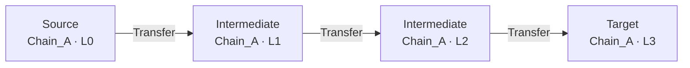

## 2. Cross_Chain_Swap_Bridge

> Swap volatile assets into a stablecoin on the origin chain, then bridge the proceeds to a target chain before final transfer to the destination wallet.

- **前置条件**: min_level=1 · roles=[Source,Asset_Conversion] · chains=[∅] · max_branches=2
- **状态效应**: branch_inc=0 · chain_transition=True → Chain_B · next=[Cross_Chain,Target]

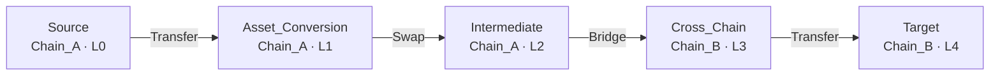

## 3. Multi_Split_Obfuscation

> One-to-N splitting: the source fans funds out into multiple parallel intermediate nodes on the same chain, which later converge into an aggregator before the final target.

- **前置条件**: min_level=1 · roles=[Source,Intermediate] · chains=[∅] · max_branches=4
- **状态效应**: branch_inc=3 · chain_transition=False · next=[Aggregator,Target]

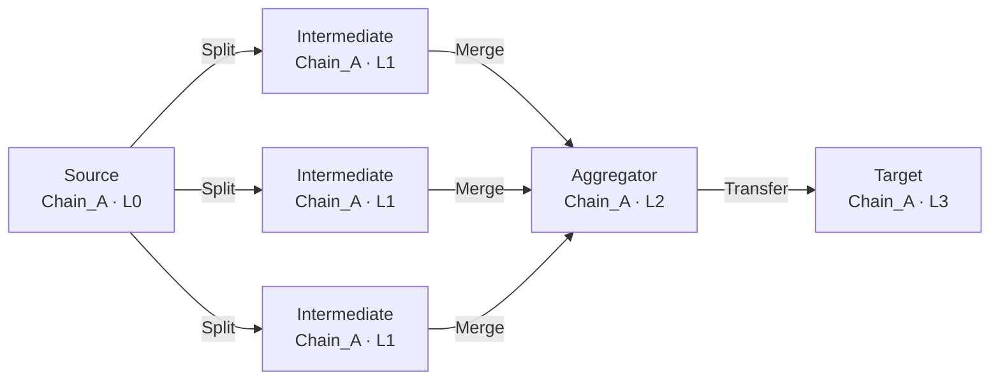

## 4. Multi_Chain_Hop_Layering

> Layered chain hopping across three distinct chains: funds bridge from chain A to chain B, then immediately bridge again to chain C, where they are finally transferred to the target.

- **前置条件**: min_level=2 · roles=[Source,Cross_Chain] · chains=[Chain_A] · max_branches=2
- **状态效应**: branch_inc=0 · chain_transition=True → Chain_C · next=[Cross_Chain,Target]

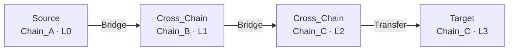

## 5. Aggregation_Merge_To_Target

> N-to-1 integration: several source streams merge into a single aggregator node, which then transfers the consolidated funds to the final target.

- **前置条件**: min_level=1 · roles=[Source,Intermediate] · chains=[∅] · max_branches=6
- **状态效应**: branch_inc=-3 · chain_transition=False · next=[Target]

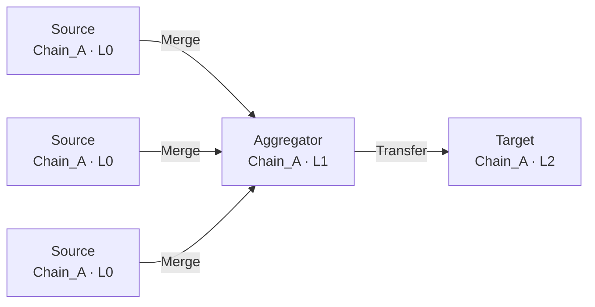

## 6. DEX_Liquidity_Pool_Swap

> Asset conversion through a decentralized exchange liquidity pool: funds are transferred into a swap node and converted into a different asset before reaching the target.

- **前置条件**: min_level=0 · roles=[Source,Asset_Conversion] · chains=[∅] · max_branches=1
- **状态效应**: branch_inc=0 · chain_transition=False · next=[Target]

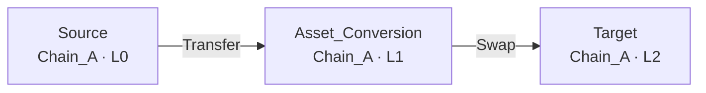

## 7. Peeling_Chain_Multi_Layer

> Deep layered peeling chain: a long sequence of linear hops through intermediate wallets on one chain, maximising the number of hops before reaching the target.

- **前置条件**: min_level=2 · roles=[Intermediate] · chains=[∅] · max_branches=1
- **状态效应**: branch_inc=0 · chain_transition=False · next=[Intermediate,Target]

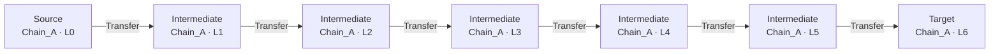

## 8. Cross_Chain_Bridge_And_Back

> Round-trip bridging: funds leave the origin chain through a bridge, pass through an intermediate chain, and are bridged back to the origin chain before final settlement.

- **前置条件**: min_level=3 · roles=[Source,Cross_Chain] · chains=[Chain_A] · max_branches=2
- **状态效应**: branch_inc=0 · chain_transition=True → Chain_A · next=[Target]

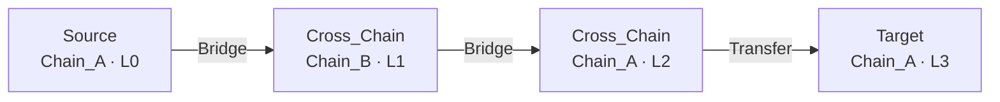

## 9. Mixer_Anonymization_Split_Merge

> Mixer-style anonymisation: funds are swapped through an asset-conversion node, split into parallel streams, and merged back into an aggregator before the final target.

- **前置条件**: min_level=2 · roles=[Source,Asset_Conversion,Intermediate] · chains=[∅] · max_branches=5
- **状态效应**: branch_inc=0 · chain_transition=False · next=[Target]

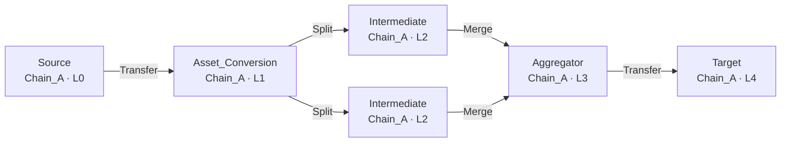

## 10. Single_Chain_Multi_Swap_Layering

> Repeated same-chain asset conversions: funds are swapped through multiple conversion nodes in sequence to obfuscate the asset trail before the final transfer.

- **前置条件**: min_level=1 · roles=[Source,Asset_Conversion] · chains=[∅] · max_branches=2
- **状态效应**: branch_inc=0 · chain_transition=False · next=[Target]

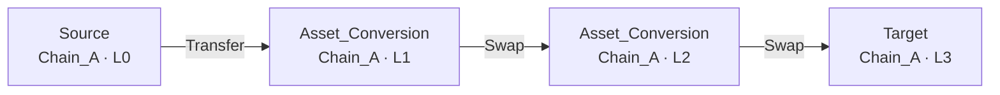

## 11. Cross_Chain_Layered_Integration

> Cross-chain layered integration: two source streams merge on the origin chain and are bridged to the target chain, where they merge again with a local stream before settlement.

- **前置条件**: min_level=3 · roles=[Source,Intermediate,Cross_Chain] · chains=[∅] · max_branches=6
- **状态效应**: branch_inc=-1 · chain_transition=True → Chain_B · next=[Target]

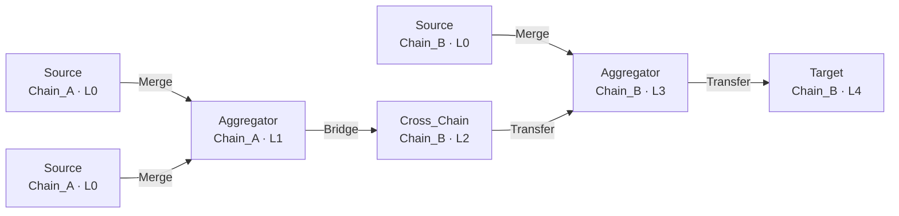

## 12. Multi_Split_Cross_Chain_Bridge

> Split-then-bridge fan-out: funds are split into parallel streams on the origin chain and each stream is bridged to a different destination chain before re-converging on the final target chain.

- **前置条件**: min_level=3 · roles=[Source,Intermediate,Cross_Chain] · chains=[∅] · max_branches=6
- **状态效应**: branch_inc=2 · chain_transition=True → Chain_B · next=[Cross_Chain,Target]

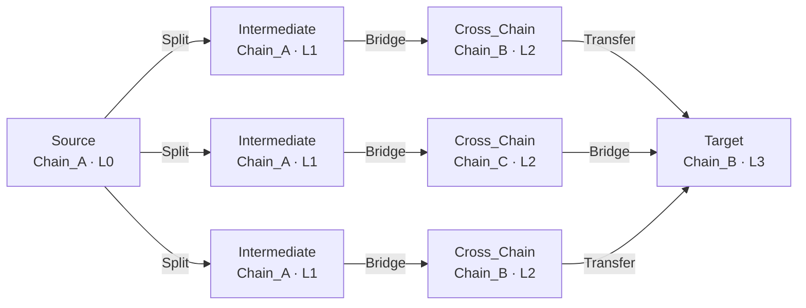
