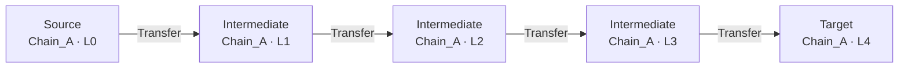

# Stage 1 · LLM 蒸馏管线（真实研报 → 拓扑 Motif）

## 输入：含微观噪音的原始研报（地址/金额/Gas 全部存在）

```text
Case #AML-2026-014 "Rapid Peel"
On 2026-07-11, wallet 0x7a2f...d9 received 412 ETH (approx. USD 1.1M) from the
exploit. Within 9 minutes the funds moved through three freshly funded
intermediate wallets (0xb1c4..., 0x9f02..., 0x33d8...), each hop keeping the
balance under 50 ETH with ~0.002 ETH gas, all on the same chain. The final hop
landed in a high-risk exchange deposit address.
```

## 处理：严格蒸馏提示词（9 条硬约束 + 内嵌 JSON Schema）

完整提示词见 `distillation_prompt.txt`（共 10763 字符）。

## 输出：mock LLM 回复（带 markdown 围栏与解说噪音，测试解析鲁棒性）

见 `mock_llm_reply.txt`；解析后通过 Pydantic 构造期校验，产出 1 个合法 DAG Motif：



## 校验后的 Motif JSON

见 `parsed_motif.json`（注意：地址 `0x7a2f...`、金额 `412 ETH`、Gas `0.002 ETH` 等微观噪音已被完全剥离）。
