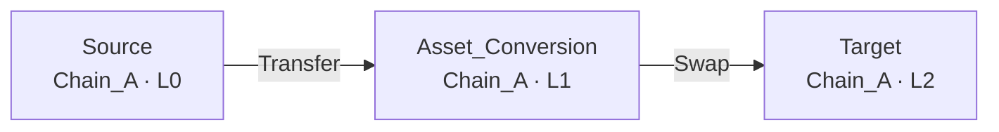
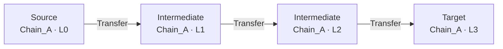

# Stage 3 · MOT 提示词压缩（Agent 先验上下文块）

> 机制：双轨检索 Top-3 → 冗余子路径消除（edge-signature 支配关系）→ Token 高效 JSON + Mermaid DAG → 作为 `<RAG_PRIOR>` 注入规划提示词。

`PromptContextCompressor`（max_motifs=3，format=hybrid）对 State_0 的输出：

````text
[AML-PRIOR-CONTEXT] Module-1 Topological Prior Knowledge (abstract motifs only; no addresses/amounts/timestamps)

<STATE>
{"current_level": 0, "current_chain": "Chain_A", "active_nodes": [{"id": "node_0", "role": "Source", "chain": "Chain_A", "lvl": 0}], "history_edges": []}
</STATE>

<QUERY>
{"scenario": "launder proceeds of a DeFi exploit via layering, cross-chain hopping and aggregation", "tactic_goal": "layer on Chain_A, bridge to Chain_B, integrate into a target", "target_pattern": null}
</QUERY>

<MOTIFS>
[MOTIF 1/2] DEX_Liquidity_Pool_Swap
{"motif_id":"DEX_Liquidity_Pool_Swap","pattern":"Token_Obfuscation","desc":"Asset conversion through a decentralized exchange liquidity pool: funds are transferred into a swap node and converted into a different asset before reaching the target.","pre":{"min_level":0,"allowed_roles":["Source","Asset_Conversion"],"required_chains":null,"max_branches":1},"nodes":[{"id":"S","role":"Source","chain":"Chain_A","lvl":0},{"id":"AC","role":"Asset_Conversion","chain":"Chain_A","lvl":1},{"id":"T","role":"Target","chain":"Chain_A","lvl":2}],"edges":[["S","AC","Transfer"],["AC","T","Swap"]],"post":{"branch_inc":0,"chain_transition":false,"target_chain":null,"next_roles":["Target"]},"score":0.7307,"rank":1}

[MOTIF 2/2] Peeling_Chain_Single_Chain
{"motif_id":"Peeling_Chain_Single_Chain","pattern":"Peeling_Chain","desc":"Rapid linear peeled transfers along a single chain: funds hop through a short chain of fresh intermediate wallets before reaching the final target.","pre":{"min_level":0,"allowed_roles":["Source","Intermediate"],"required_chains":null,"max_branches":1},"nodes":[{"id":"S","role":"Source","chain":"Chain_A","lvl":0},{"id":"I1","role":"Intermediate","chain":"Chain_A","lvl":1},{"id":"I2","role":"Intermediate","chain":"Chain_A","lvl":2},{"id":"T","role":"Target","chain":"Chain_A","lvl":3}],"edges":[["S","I1","Transfer"],["I1","I2","Transfer"],["I2","T","Transfer"]],"post":{"branch_inc":0,"chain_transition":false,"target_chain":null,"next_roles":["Intermediate","Target"]},"score":0.6946,"rank":2}

</MOTIFS>

<INSTRUCTION>
Use the motifs above ONLY as topological priors for the next DAG-extension action. Pick at most one motif, map its abstract nodes/edges onto the current state (re-indexing temp ids), and respect the motif preconditions and the global DAG constraints. Never introduce wallet addresses, amounts, gas or timestamps.
</INSTRUCTION>
````

- 节点压缩为 4 键 dict（`id/role/chain/lvl`），边压缩为 MOT 三元组 `[source, target, operation]`；
- 每个 Motif 附带 `score` 与 `rank`，并渲染为 Mermaid DAG，让 LLM 一眼读取拓扑方向；
- 被更大候选完全支配的子路径会被剔除，节省上下文 Token。
