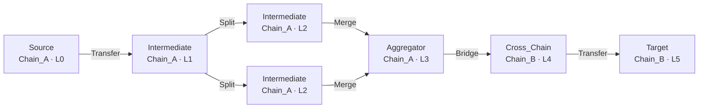

# Stage 5 · 最终行为图 G_b（决策图）

场景 `showcase-跨链分层归集`：success=True，终止方式 `agent_terminate`，未满足目标：无（全部达成）。

## 图统计

| 指标 | 值 |
|---|---|
| 节点数 | 7 |
| 边数 | 7 |
| 规划步数 | 5 |
| 最大层级 | 5 |
| 分支度上限 d_max | 4 |
| 层级上限 L_max | 8 |
| 终止方式 | agent_terminate |
| 起始链 | Chain_A · Source |

## 决策图（Mermaid flowchart）

## 边清单

| 边 | 操作 |
|---|---|
| `node_0` → `node_1` | Transfer |
| `node_1` → `node_2` | Split |
| `node_1` → `node_3` | Split |
| `node_2` → `node_4` | Merge |
| `node_3` → `node_4` | Merge |
| `node_4` → `node_5` | Bridge |
| `node_5` → `node_6` | Transfer |

完整图 JSON 见 `graph.json`（供 Stage-2 条件图扩散模型消费）。
