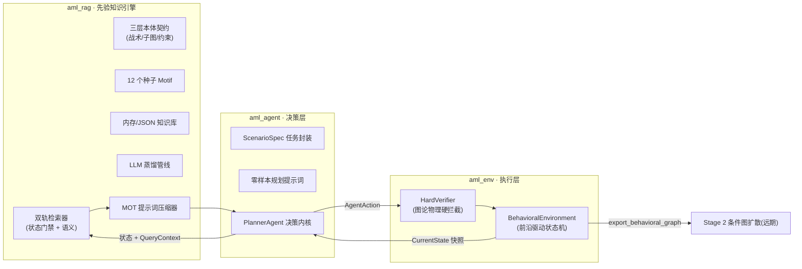
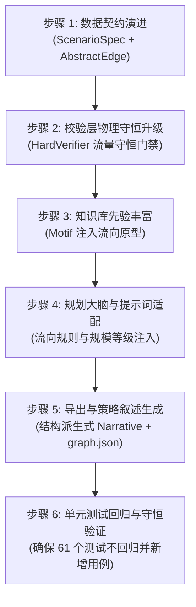
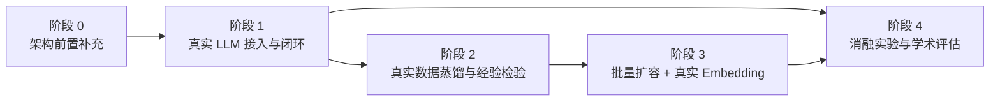

这是一份整合了我们最新讨论成果的**修订版工作文档**。

我们在原有基础上做了关键补充：

1. **新增“架构补充与实施顺序（阶段 0）”**：在正式接入真实 LLM 前，明确了宏观资金规模等级（`scale_tier`）、拓扑流向权重（`flow_share`）、流量守恒硬约束以及结构派生式策略叙述的代码改造顺序；
2. **扩充“真实数据蒸馏与经验性验证（阶段 2）”**：补齐了导师关注的“知识量充分性与提取客观性”验证（结构合法率、跨源一致性度量、模式饱和度分析）；
3. **完善“消融实验与评估指标（阶段 4）”**：加入了流量守恒率和基于相对比例的模式区分度（如严格区分 Peeling 与 Split）。

---

# 阶段总结与后续演进与测试计划

> **日期**：2026-08-30（修订版）  
> **范围**：Stage-1 三大模块开发总结、前置架构补充实施顺序，及后续四阶段实证测试计划  
> **当前验证状态**：61 个单元测试全部通过，核心闭环已跑通，待完成架构增强后接入真实 LLM

---

## 一、目前完成的工作总结

### 1.1 三大模块与闭环架构

阶段一（宏观行为决策）已完成软件骨架落地，形成 **“先验知识库 $\to$ 状态环境 $\to$ 规划 Agent”** 的三层闭环：

| 模块        | 核心交付                                            | 关键设计                                                                                                                                            |
| :---------- | :-------------------------------------------------- | :-------------------------------------------------------------------------------------------------------------------------------------------------- |
| `aml_rag`   | 12 个种子 Motif、双轨检索器、蒸馏管线、上下文压缩器 | Pydantic v2 构造期强校验（Kahn 判环、level 递增、$d_{max}$）；$\text{Score}=\alpha\cos+(1-\alpha)\text{RuleSat}$；MOT 三元组压缩 + Mermaid DAG 呈现 |
| `aml_env`   | 硬约束校验器、增量 DAG 状态机                       | 前沿“出度饱和可复用”；非法动作零改动幂等；`Terminate` 统一走 `step`；五类终止条件检查                                                               |
| `aml_agent` | 决策循环、轨迹审计、Planner 协议                    | LLM 以 `Callable[[str],str]` 协议注入；校验错误回喂反思（$\le 3$ 次）；重试耗尽安全终止；`ScenarioGoals` 结构目标达成判定                           |

### 1.2 现有测试与验证现状

- **单元测试 61 个全绿**：覆盖 RAG 检索管线（33）、环境状态转移（18）、Planner 规划逻辑（10）；
- **脚本化端到端冒烟通过**：验证了 `Transfer → Split → Merge → Bridge → Transfer → Terminate` 轨迹，达成 `success=True`，审计字段完备留痕；
- **解决的关键语义缺陷**：
  1. 角色门控由“严格子集”调整为“重叠语义”，消除了多角色前沿下的死锁；
  2. 实现了硬门控空结果时的“先验保障软回退”机制（`strict=False` 降级兜底）。

---

## 二、架构前置补充与实施顺序（阶段 0）

为了解决同构子图的语义区分问题（如 Peeling Chain 与 Uniform Split 在纯拓扑上同构），并使 Stage-1 的抽象图能够无缝承接 Stage-2 条件图扩散模型，**必须在接入真实 LLM 之前，按照依赖顺序完成以下架构增强**：

### 实施步骤清单：

1. **数据契约层演进**：
   - 场景定义扩展：引入宏观资金体量枚举 `scale_tier`（如 `Retail`、`Medium`、`Whale`）及可选的全局目标金额标量（静态元数据，规划循环中不参与扣减计算）；
   - 边抽象扩展：在边契约中增加无量纲的归一化流向权重 `flow_share`（默认值 `1.0`，向下兼容既有单向转移）。
2. **硬约束校验层升级**：
   - 在 `HardVerifier` 中增加**分流守恒校验门禁**：在节点发生 `Split` 操作时，强制校验其所有出边的流向比例满足 $\sum \text{flow\_share} \approx 1.0 \pm 0.01$；
   - 违规时生成标准化错误文本，以便触发 Agent 纠错反思。
3. **知识库模式增强**：
   - 在种子 Motif 中补充典型流向原型（如为 Peeling Chain 注入 `[0.90, 0.10]` 比例模板，为均等 Split 注入 `[0.50, 0.50]`）；
   - 上下文压缩器在构造先验提示时，附带流向原型信息。
4. **决策 Agent 与提示词适配**：
   - 提示词明确要求 Agent 在执行 Split 操作时指定守恒的 `flow_share`，并指引其优先采纳 RAG 提供的模式原型；
   - 动作解析器增强，支持安全提取流向权重属性。
5. **策略叙述生成与导出**：
   - 实现结构派生式的最终策略叙述生成器，依据执行成功的模式序列与跨链路径确定性生成自然语言战术摘要；
   - `graph.json` 导出包含 `scale_tier`、`flow_share` 以及策略叙述元数据。
6. **兼容性与回归验证**：
   - 运行测试套件，确保前述改动对既有 61 个单元测试 100% 向后兼容，并补充针对流量守恒拦截的专项单测。

---

## 三、后续四阶段测试与实验计划

架构补充完成后，按依赖链正式启动实验推进：

### 阶段 1：真实 LLM 接入与基线验证（预计 1 周）

**目标**：在 12 个种子 Motif 环境下接入真实 LLM 端点，量化模型的基础指令遵循与拓扑规划能力。

| #   | 测试项           | 实施方法与评价指标                                                                             |
| :-- | :--------------- | :--------------------------------------------------------------------------------------------- |
| 1.1 | 客户端适配器冒烟 | 实现 OpenAI 兼容的轻量客户端，满足 `Callable[[str], str]` 协议，验证超时重试与 JSON 解析稳定性 |
| 1.2 | 基础动作合法性   | 真实 LLM $\times$ 3 个场景 $\times$ 10 条轨迹，统计动作合法率、重试耗尽率及平均步数            |
| 1.3 | 格式与枚举遵循度 | 统计 JSON 提取成功率、是否存在虚构动作枚举或无效节点引用的情况                                 |
| 1.4 | 守恒规则遵循度   | 评估 Agent 在无修正与有 Verifier 反思修正情况下，生成守恒流向比例（$\sum=1.0$）的达标率        |
| 1.5 | 成本与时延记录   | 采集单步及全轨迹的 Token 消耗、生成延迟，为消融实验沉淀基线数据                                |

**验收标准**：连续 10 条真实 LLM 驱动的规划轨迹满足 `success=True`，单步平均反思重试 $< 0.5$ 次。

---

### 阶段 2：真实数据蒸馏与经验性检验（预计 1~2 周）

**目标**：使用 3~5 篇典型跨链安全事件研报运行蒸馏管线，**对知识库来源的充分性与客观性进行经验性学术验证**，确立批量入库质量基准。

| #   | 测试项         | 实施方法与评价指标                                                                                                                |
| :-- | :------------- | :-------------------------------------------------------------------------------------------------------------------------------- |
| 2.1 | 拓扑提炼合法率 | 统计从研报中蒸馏出的子图通过 Kahn 算法无环检测与出入度约束的比例（需 $\ge 90\%$）                                                 |
| 2.2 | 跨源一致性度量 | 选取同一安全事件的不同独立报告（如慢雾、CertiK 对同一案情分析），分别独立蒸馏，计算核心拓扑算子的子图同构性，证明知识提取的客观性 |
| 2.3 | 微观噪声净化率 | 全量抽检蒸馏产物，审计是否存在具体钱包地址、真实金额、Gas 费或时间戳残留（零微观噪声达标率 100%）                                 |
| 2.4 | 模式饱和度分析 | 记录随着分析报告数量增加，新增独立拓扑模式数量的边际变化，量化评估模式收敛趋势                                                    |
| 2.5 | 检索与回归校验 | 将新蒸馏的 Motif 合并入库，验证双轨检索器在多样化先验下的检索准确率与已有测试集回归表现                                           |

**验收标准**：蒸馏合法率 $\ge 90\%$，跨源同构验证通过，微观数值噪声为零，全部测试无回归。

---

### 阶段 3：知识库批量扩容与真实 Embedding（预计 2~3 周）

**目标**：将知识库扩展至生产/学术规模，嵌入模型由离散哈希升级为密集向量。

| #   | 测试项         | 实施方法与评价指标                                                                                    |
| :-- | :------------- | :---------------------------------------------------------------------------------------------------- |
| 3.1 | 知识库规模扩充 | 蒸馏入库 50+ 个涵盖 Chain Hopping、Peeling、Split-Merge 变体的标准 Motif，均配置规范流向原型          |
| 3.2 | 向量嵌入一致性 | 接入预训练文本嵌入模型，与离散基线进行排序相关性对比（Spearman 相关系数），验证语义排序有效性         |
| 3.3 | 检索空间鲁棒性 | 在大候选集下测试状态门禁的剪枝率与候选召回质量，确保不会由于候选集增加引入检索退化                    |
| 3.4 | 超参数配置解耦 | 将图参数（$d_{max}$、$L_{max}$）及检索加权系数（$\alpha$、$\text{top\_k}$）移出代码层，统一外部化配置 |

**验收标准**：50+ 结构合规的 Motif 完备入库；密集检索排序稳定；两组不同超参数配置下回归测试全绿。

---

### 阶段 4：四组对比消融实验与学术评估（预计 2~4 周）

**目标**：全面量化 RAG 先验对规划代理的引导效力，验证数据合成架构相较于静态标签化数据集的核心优势，形成完整的实验数据支撑。

#### 1. 对照组设计

1. **Group A (Rule-based Baseline)**：规则规划器，按硬编码逻辑组合拓扑，作为确定性基线；
2. **Group B (Vanilla Agent)**：仅输入场景目标与图语法规则，不提供任何 RAG 先验上下文；
3. **Group C (Flat-RAG Agent)**：输入研报原始自然语言切块片段，通过传统文本 RAG 检索注入；
4. **Group D (Struct-RAG Agent)**：完整方案（三层本体知识库 + 双轨状态感知检索 + MOT 上下文压缩）。

#### 2. 多维度量指标

- **拓扑物理合规性**：DAG 合法率（Kahn Pass Rate）、无环率、流量守恒达成率（$\sum \text{flow\_share} = 1.0$）；
- **战术模式匹配度（Typology Match）**：利用图模式匹配算法，检测生成图中包含的典型洗钱子图数量（得益于流向权重，能够严格区分 Peeling Chain 与均匀 Split）；
- **图结构多样性与复杂度**：Weisfeiler-Lehman (WL) 树核距离、拓扑图熵、平均路径深度、跨链转移频次；
- **规划效率与稳定性**：平均生成步数、Verifier 拦截重试次数、重试耗尽失败率、每图平均 Token 成本。

**验收标准**：在 $\ge 20$ 个跨链场景下完成多轮评估，统计均值与方差，证明 Struct-RAG 在拓扑合规性、反洗钱模式纯度及生成多样性上具备统计显著性优势（$p < 0.05$）。

---

## 四、工程与学术注意点

1. **解耦铁律保持**：在整个实验过程中，严格保持 Stage-1“零微观数值噪声”的界限，所有关于资金规模的输入均作为静态宏观意图，具体微观金额与地址完全保留至远期 Stage-2 扩散模型；
2. **实验可复现性**：记录所有实验使用的模型版本号、随机数种子、采样温度（建议固定为 0.1）与 Prompt 模版版本；
3. **学术答辩支撑**：阶段 2 的经验性实验（合法率、跨源一致性、信息饱和度）与阶段 4 的消融实验数据，直接作为论文 Methodology 与 Evaluation 章节的实证支撑材料。
