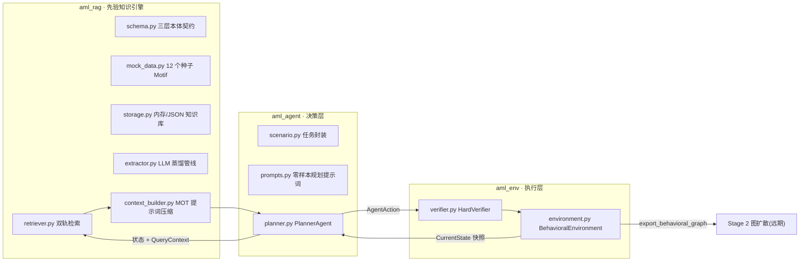
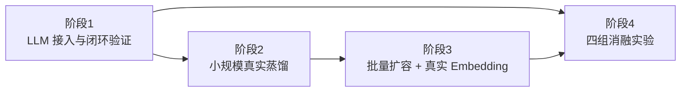

# 阶段总结与后续测试计划

> **日期**:2026-08-30
> **范围**:Stage-1 三大模块(知识库 / 环境 / Agent)开发阶段总结,及"真实 LLM 实验"四阶段测试建议
> **当前验证状态**:61 个单元测试全部通过,端到端闭环可用(LLM 与真实数据尚未接入)

---

## 一、目前完成的工作总结

### 1.1 三大模块与闭环架构

截至当前,阶段一(宏观行为决策)的完整软件骨架已落地,形成
**"先验知识库 → 状态环境 → 规划 Agent"** 三层闭环:

| 模块        | 核心交付                                            | 关键设计                                                                                                                                   |
| ----------- | --------------------------------------------------- | ------------------------------------------------------------------------------------------------------------------------------------------ |
| `aml_rag`   | 12 个种子 Motif、双轨检索器、蒸馏管线、提示词压缩器 | Pydantic v2 构造期强校验(Kahn 判环、level 递增、$d_{max}$);$\text{Score}=\alpha\cos+(1-\alpha)\text{RuleSat}$;MOT 三元组压缩 + Mermaid DAG |
| `aml_env`   | 硬约束校验器、增量 DAG 状态机                       | 前沿"出度饱和可复用";非法动作零改动幂等;`Terminate` 统一走 `step`;五类终止条件                                                             |
| `aml_agent` | 决策循环、轨迹审计、Planner 协议                    | LLM 以 `Callable[[str],str]` 注入;拒绝错误回喂重试(≤3);重试耗尽安全终止;`ScenarioGoals` 结构成功判定                                       |

### 1.2 测试与验证现状

- **单元测试 61 个全部通过**:`test_rag_pipeline.py`(33)、`test_environment.py`(18)、`test_planner.py`(10);
- **端到端冒烟已验证**:脚本化 LLM 驱动完整轨迹 `Transfer → Split → Merge → Bridge → Transfer → Terminate`,`success=True`、reward=1.0,审计字段(`prior_motif_ids`、`retry_reasons`、`llm_calls`)逐步留痕;
- **开发中修复的两个真实语义缺陷**:
  1. 角色门控由"严格子集"改为"重叠语义"(多角色前沿下的压力死锁);
  2. 检索硬门控空结果时的"先验保障软回退"(`strict=False` 降级 + `prior_soft_fallback` 审计标记)。

### 1.3 尚未接入的两个"真实"组件

1. **真实 LLM**:目前 `PlannerAgent` / `MotifExtractor` 均由脚本化 mock 驱动,真实模型行为(JSON 遵循率、枚举幻觉、约束遵循度)未验证;
2. **真实洗钱数据**:知识库仅有 12 个手工策展的种子 Motif(模式真实但数量少),尚未通过 `extractor.py` 从 Chainalysis/Elliptic 等研报批量蒸馏入库。

---

## 二、后续四阶段测试建议

推进顺序由依赖链决定:**蒸馏管线本身是 LLM 驱动的,因此必须先接 LLM,再做真实数据蒸馏**;批量入库以前提是蒸馏质量达标;消融实验依赖稳定的 LLM 与完整知识库。

### 阶段 1:LLM 接入与闭环验证(建议 1 周)

**目标**:用现有 12 个种子 Motif 跑通真实 LLM 驱动的完整闭环,量化模型行为基线。

| #   | 测试项         | 方法与判据                                                                                                     |
| --- | -------------- | -------------------------------------------------------------------------------------------------------------- |
| 1.1 | LLM 适配器冒烟 | OpenAI 兼容端点封装为 `Callable[[str],str]`,固定 prompt 返回确定性 JSON;建议开启 `response_format=json_object` |
| 1.2 | 动作合法性基线 | 真实 LLM × 3 个场景 × 10 条轨迹,统计单步动作合法率、平均重试次数、重试耗尽率                                   |
| 1.3 | 格式遵循率     | 统计无需围栏剥离即可解析的回复比例;枚举幻觉(如 `"teleport"`)、`parent_ids` 引用不存在节点的比例                |
| 1.4 | 提示词有效性   | 观察零样本效果;若单步合法率 < 80%,补 2~3 个 few-shot 示例后对比                                                |
| 1.5 | 成本/延迟基线  | 记录每条轨迹的 Token 开销与耗时(消融实验的基线数据)                                                            |

**验收标准**:连续 10 条轨迹 `success=True`,且平均重试 < 0.5 次/步。

### 阶段 2:小规模真实数据蒸馏(建议 1~2 周)

**目标**:用 3~5 篇公开研报验证蒸馏质量门槛,再决定是否批量。

| #   | 测试项         | 方法与判据                                                                    |
| --- | -------------- | ----------------------------------------------------------------------------- |
| 2.1 | 蒸馏合法性     | 蒸馏产出的每个 Motif 必须通过 `TopologicalMotif` 构造期校验(DAG/level/分支度) |
| 2.2 | 去噪音抽查     | 全量人工抽检:无地址、金额、Gas、时间戳残留(零微观数字噪音)                    |
| 2.3 | 前置条件合理性 | 抽检 `preconditions` 与模式语义一致(`min_level`、角色、链、分支上限)          |
| 2.4 | 检索联动回归   | 新 Motif 入库后,全套 61 个测试 + 新增集成用例仍通过                           |
| 2.5 | 提示词迭代记录 | 记录蒸馏提示词版本与抽检通过率的对应关系                                      |

**验收标准**:抽检通过率 ≥ 90%;蒸馏 Motif 全部通过 Pydantic 校验且为合法 DAG。

### 阶段 3:批量扩容 + 真实 Embedding(建议 2~3 周)

**目标**:知识库达到研究规模,嵌入后端从 mock 升级为真实模型。

| #   | 测试项     | 方法与判据                                                                                                              |
| --- | ---------- | ----------------------------------------------------------------------------------------------------------------------- |
| 3.1 | 扩容规模   | 知识库蒸馏至 50+ Motif,覆盖 Chain Hopping / Peeling / Split-Merge 变体,批量入库后抽检率 ≥ 30%                           |
| 3.2 | 嵌入一致性 | sentence-transformers / OpenAI 嵌入与 `DeterministicHashEmbedder` 做 Spearman 排序相关性对比,验证 mock 嵌入的排序可靠性 |
| 3.3 | 检索回归   | 扩容后重跑门控/排序相关测试,确认无新 Motif 引发空结果或质量退化                                                         |
| 3.4 | 参数外部化 | `alpha` / `top_k` / `d_max` / `L_max` 迁移到配置文件,同一套测试在两组配置下均通过                                       |

**验收标准**:50+ Motif 全量通过校验;Spearman 相关性报告产出;配置化后回归全绿。

### 阶段 4:四组消融实验(建议 2~4 周)

**目标**:量化 RAG 先验对行为图生成的贡献,产出论文级对比报告。

| #   | 测试项              | 方法与判据                                                                                                                      |
| --- | ------------------- | ------------------------------------------------------------------------------------------------------------------------------- |
| 4.1 | Rule-based Baseline | 实现 `RuleBasedPlanner`(实现已定义的 `Planner` 协议),固定策略生成合法 DAG                                                       |
| 4.2 | Vanilla Agent       | 移除 RAG 先验段,仅给场景 + 动作规则,其余与 Struct-RAG 完全一致                                                                  |
| 4.3 | Flat-RAG Agent      | 将研报纯文本切块 + 语义检索注入(对照结构化先验)                                                                                 |
| 4.4 | Struct-RAG Agent    | 现架构(双轨检索 + MOT 压缩)                                                                                                     |
| 4.5 | 评估指标体系        | 固定场景集(≥ 20 场景)× 4 组,采集:DAG Pass Rate、步长/度约束覆盖率、拓扑熵、WL 树核多样性、Typology Match、收敛步数与 Token 开销 |
| 4.6 | 显著性统计          | 多场景多轮重复,报告均值 ± 标准差与组间差异                                                                                      |

**验收标准**:四组结果可复现(固定模型版本/温度/提示词版本),输出对比报告与图表。

---

## 附:工程注意点

- **成本控制**:开发迭代用小模型(如 `gpt-4o-mini` 级),正式实验再换强模型;
- **可复现性**:所有实验固定模型版本、temperature 与提示词版本号,写入轨迹元数据;
- **合规**:蒸馏仅抽取抽象拓扑(零微观数字噪音),密钥走环境变量不入代码库;
- **并行空间**:阶段 1 开发期间可同步开展阶段 2 的数据**收集**(仅收集、不蒸馏)。
