# 阶段总结与后续演进计划（第三版 · 事实校准修订）

> **日期**：2026-10-11（第三版）  
> **范围**：阶段 0–2 成果总结、阶段 3（进行中）现状核对，以及剩余工作的演进展望  
> **校准依据**：`step1`–`step6` 各阶段任务书与 `总结.md`、`experiments/` 三个阶段实跑归档、当前源码与数据资产实测  
> **当前实测基线（2026-10-11）**：310 项单元测试全绿（17.95 s）；知识库 18 个 Motif；56 篇研报池（14 篇黄金定标集 + 42 篇负向对照）

---

## 〇、修订说明与事实校准方法

第二版（2026-08-30）写作于阶段 0 完成后、阶段 1 启动前，其中阶段 2–4 的内容属于**计划值**。此后项目按 `step3`–`step6` 的顺序推进了六个工作包。本版在第二版基础上做事实性验证与修改，方法如下：

1. **文档交叉核对**：逐项阅读 `step3`–`step6` 的任务书与 `总结.md`，还原各阶段真实执行内容与验收口径；
2. **实验归档复算**：直接读取 `experiments/phase1_deepseek_baseline/`、`phase2_distillation_empirical/`、`phase3_dense_retrieval/` 下的归档 JSON，以归档数值为准；
3. **源码与资产实测**：实测当前测试套件（`pytest` 全量 310 项通过）、物理知识库 `data/distilled_kb.json`（18 个 Motif）、研报台账 `data/raw_reports/manifest.csv`（56 行）与资格审计 `eligibility_audit.json`（56 条记录）。

### 与第二版的关键事实差异对照

|  #  | 第二版表述（计划值）                                | 第三版校准（实测值）                                                                                                                                       |
| :-: | :-------------------------------------------------- | :--------------------------------------------------------------------------------------------------------------------------------------------------------- |
|  1  | 61 个单元测试全绿                                   | 测试基线已增长至 **310 项**（阶段 0→1→2→3A 依次为 97 → 108 → 123 → 184，采集与加固阶段 216 → 237，当前实测 310）                                           |
|  2  | 阶段 1 验收标准“连续 10 条轨迹”                     | 实际执行 **3 场景 × 3 条 = 9 条轨迹**，达成率 100%，平均重试 0.405 次（满足 `< 0.5` 验收线）                                                               |
|  3  | 阶段 2 跨源一致性拟用“慢雾 / CertiK”同构对比        | 实际采用 **CertiK 与 Zerion** 针对 2022 Nomad Bridge 事件盲测；度量演化为双轨制，`global_topology_jaccard = 0.6667`                                        |
|  4  | 阶段 3 计划“直接批量扩容 50+ Motif”                 | 阶段 3 拆分为 **Part A（Dense 检索升级，已完成）** 与 **Part B（批量蒸馏，待执行）**；Part B 前置新增两项第二版未规划工作（账本公理加固、PRISMA 采集定标） |
|  5  | 知识库 12 个种子 Motif                              | 已扩容至 **18 个 Motif**（12 种子 + 6 实战蒸馏）；50+ 目标尚未达成                                                                                         |
|  6  | 阶段 3.3（检索鲁棒性）/ 3.4（超参外置）列为整体计划 | **均尚未执行**，仍为待办事项（评测报告中 `coarse_k = null`，超参仍在脚本内）                                                                               |
|  7  | 阶段 4 消融实验列入计划                             | **尚未启动**；已沉淀阶段 1 与阶段 3 两份基线报告作为对照锚点                                                                                               |
|  8  | 无独立数据采集子系统规划                            | 新增 `tools/crawler/` 采集子系统与 PRISMA 双层定标流程，产出 56 篇研报池与 14 篇黄金定标集                                                                 |

---

## 一、总体进度全景（截至 2026-10-11）

```mermaid
flowchart LR
    P0["阶段 0<br/>架构前置增强<br/>✅ 完成 (97 测试)"] --> P1["阶段 1<br/>真实 LLM 基线<br/>✅ 完成 (108 测试)"]
    P1 --> P2["阶段 2<br/>蒸馏与四重检验<br/>✅ 完成 (123 测试)"]
    P2 --> P3A["阶段 3 Part A<br/>Dense 检索升级<br/>✅ 完成 (184 测试)"]
    P3A --> P3P["阶段 3 Part B 前置<br/>账本加固 + PRISMA 定标<br/>✅ 完成 (310 测试)"]
    P3P --> P3B["阶段 3 Part B<br/>14 篇批量蒸馏扩容<br/>🟡 待启动 (目标 50+ Motif)"]
    P3B --> P3C["阶段 3 收尾<br/>检索鲁棒性 + 超参外置<br/>⬜ 待办"]
    P3C --> P4["阶段 4<br/>四组消融与学术评估<br/>⬜ 待启动"]
    P4 --> P5["阶段 5（新增）<br/>Stage-2 扩散模型交接<br/>⬜ 远期"]
```



| 阶段               | 状态 | 核心交付（实测）                                                       | 验收结论                                       |
| :----------------- | :--: | :--------------------------------------------------------------------- | :--------------------------------------------- |
| 阶段 0 架构前置    |  ✅  | `ScaleTier`、`flow_share`、守恒门禁、流向原型、结构派生式叙述          | 97 项测试全绿，守恒穿透审计通过                |
| 阶段 1 真实 LLM    |  ✅  | deepseek-flash 适配器、9 条实跑轨迹、`phase1_report.json`              | 达成率 100%、重试 0.405 < 0.5                  |
| 阶段 2 蒸馏检验    |  ✅  | 手册蒸馏 7→6 入库、Nomad 跨源 0.6667、零噪声 100%                      | 合法率 100% ≥ 90%、跨源 ≥ 0.50、噪声 0         |
| 阶段 3 Part A      |  ✅  | Dense Provider（all-MiniLM-L6-v2）、双轨分层检索、Spearman 对比报告    | $\bar{\rho}=0.698$、6/8 显著、只读审计通过     |
| 阶段 3 Part B 前置 |  ✅  | 账本公理加固（跨链 BRIDGE / 单出边守恒）、56 篇研报池、14 篇黄金定标集 | 310 项测试全绿、台账无空值、3 篇假阳性人工排除 |
| 阶段 3 Part B 本体 |  🟡  | 14 篇黄金集批量蒸馏 → 50+ Motif                                        | —（下一工作包）                                |
| 阶段 4 消融实验    |  ⬜  | 四组对照 + 多维指标 + 显著性检验                                       | —                                              |

---

## 二、已完成工作总结（阶段 0 – 阶段 3 现状）

### 2.1 阶段 0：架构前置增强（已完成，见第二版第二章）

第二版规划的六步架构改造已全部落地并通过防御性穿透审计：

- 数据契约引入 `ScaleTier`（Retail / Medium / Whale）与边级 `flow_share`（默认 1.0，向后兼容）；
- `HardVerifier` 增加分流守恒门禁（$\sum \text{flow\_share} \approx 1.0 \pm 0.01$）并输出标准化纠错文本；
- 种子 Motif 注入流向原型（Peeling `[0.90, 0.10]`、均等 Split `[0.50, 0.50]` 等）；
- 提示词与动作解析器支持守恒权重；`narrative.py` 实现结构派生式策略叙述；`graph.json` 导出含新字段；
- 测试基线由 61 项升至 **97 项**，其中守恒穿透套件专门验证“非法分流被硬拦截”。

### 2.2 阶段 1：真实 LLM 接入与基线验证（已完成）

**执行内容**：接入 `deepseek-flash`（OpenAI 兼容协议，温度 0.1），实现高可用客户端适配器（`aml_agent/client.py`，含 429 指数退避与 Token/延迟遥测），强化输出解析器对代码围栏与格式噪声的容错，并落地两级评测脚本（`scripts/smoke_deepseek.py` 与 `scripts/benchmark_phase1.py`）。

**实测结果**（源自 `experiments/phase1_deepseek_baseline/phase1_report.json`）：

| 场景                     | 轨迹数 |  达成率  | 守恒初检遵循率 | 守恒修复率 | 平均步数 | 平均重试/步 |
| :----------------------- | :----: | :------: | :------------: | :--------: | :------: | :---------: |
| retail_single_chain      |   3    |   100%   |      100%      |    100%    |   4.0    |     0.0     |
| whale_cross_chain_mixing |   3    |   100%   |     96.4%      |    100%    |   9.33   |    1.214    |
| medium_peeling_split     |   3    |   100%   |      100%      |    100%    |   5.0    |     0.0     |
| **总体**                 |   9    | **100%** |       —        |  **100%**  |    —     |  **0.405**  |

- **验收结论**：9 条轨迹全部 `success=True`；平均反思重试 0.405 次满足 `< 0.5` 验收线；每场景的 Prompt/Completion Token 与单步延迟已全量记录，成为消融实验的效率底表；
- 冒烟产物 `smoke_graph.json` 完成纯净度审计并输出 `strategy_narrative`，作为 Stage-2 的**首个黄金输入契约样本**；
- 测试基线升至 **108 项**；`meta_config.txt` 记录模型、温度与轨迹数，保证可复现。

### 2.3 阶段 2：工业研报蒸馏与四重经验检验（已完成）

**执行内容**：在 `aml_rag/` 下实现蒸馏管线（`distiller.py`：格式无关分段 + 滑动窗口 + 防御性反序列化与反思自愈）、四大经验性检验（`evaluation.py`）、安全入库（`storage.py` 同构去重），输入慢雾《Crypto-Asset-Tracing-Handbook》。

**实测结果**（源自 `experiments/phase2_distillation_empirical/distillation_report.json`）：

| 环节           | 实测值                                                         | 验收线      |
| :------------- | :------------------------------------------------------------- | :---------- |
| 分段 / 蒸馏    | 9 chunks → 7 Motif，0 失败                                     | —           |
| 同构去重       | 拦截 1 个同构变体（`multi_hop_transfer_chain_v1`），入库 6 个  | —           |
| 知识库规模     | 12 种子 → **18 Motif**（`data/distilled_kb.json`）             | —           |
| Check 1 合法率 | **100%**（7/7 通过 Kahn 无环 + 出度 + 守恒三重校验）           | ≥ 90% ✅    |
| Check 2 跨源   | `global_topology_jaccard = 0.6667`（详见 2.3.1）               | ≥ 0.50 ✅   |
| Check 3 零噪声 | `residue_count: 0`                                             | 100% ✅     |
| Check 4 饱和度 | 9 段边际新增曲线 `[0,0,1,1,1,1,1,1,1]`，概念段零贡献被正确过滤 | 收敛趋势 ✅ |

**2.3.1 Nomad Bridge 跨源一致性攻坚（Check 2）**：针对 2022 Nomad Bridge 事件引入 CertiK 安全博文与 Zerion 链上追踪报告盲测，经历三轮算法迭代——初始 `pattern_type` 标签漂移导致 Jaccard 0.0，经“全局边算子集合 Jaccard 双轨度量”（忽略局部标签、对比算子并集）升至 0.3333，最终以“复合事件感知提示 + 语义锚定”收敛至 **0.6667**：

```
CertiK  算子集: {Bridge, Transfer}
Zerion  算子集: {Bridge, Swap, Transfer}
global_topology_jaccard = 2/3 = 0.6667   （双方均 valid_rate 1.0、residue 0）
```

**结论**：两份独立来源在核心算子 Bridge + Transfer 上强共识，证明知识提取客观收敛而非模型幻觉；同时保留 `pattern_strict_jaccard = 0.25` 作为敏感度参照，双轨度量并存。测试基线升至 **123 项**；评测流与入库流物理级解耦（`eval_cross_source.py` 零写盘）。

### 2.4 阶段 3（进行中）：Dense 检索升级 + 批量扩容前置准备

#### 2.4.1 Part A：预训练 Dense 嵌入升级（已完成）

- **可插拔嵌入契约**：`aml_rag/embedding.py` 定义统一 `EmbeddingProvider`（单条/批量嵌入 + 余弦相似度 + 内存缓存），落地 `DenseEmbeddingProvider`（默认 `all-MiniLM-L6-v2`，懒加载、离线自动降级至哈希引擎）与 `DiscreteEmbeddingProvider`（离散词法基线）；
- **双轨分层检索**：`retriever.py` 重构为“语义粗排 → 拓扑硬门禁精排 + 融合加权”，打分公式物理意义不变（$\text{Score}=\alpha\cos+(1-\alpha)\text{RuleSat}$），对上游 Agent **零破坏性重构**；
- **量化对比评测**（`scripts/eval_retrieval_correlation.py`，归档于 `experiments/phase3_dense_retrieval/dense_vs_discrete_correlation.json`）：

| 核心指标               | 实测值                             | 学术含义                                      |
| :--------------------- | :--------------------------------- | :-------------------------------------------- |
| 平均 Spearman 相关系数 | **0.6983**（区间 0.238–0.940）     | Dense 兼具拓扑约束传承与高维语义重排          |
| Top-1 一致率           | **50%**（8 查询中 4 个分歧）       | 半数场景下预训练向量改变了注入 LLM 的核心先验 |
| 统计显著性达标率       | **75%（6/8，$p<0.05$）**           | 排除随机扰动                                  |
| Top-1 区分度裕量       | 案例中提升近 3 倍（0.0307→0.0851） | 缓解离散词频下的平局与噪声干扰                |
| 知识库只读审计         | `kb_read_only_verified: true`      | SHA-256 前后校验，评测流零污染生产资产        |

- 真实端点冒烟（`smoke_deepseek.py`）通过，涌现 **14 节点 / 17 边**的复杂跨链拓扑；测试基线升至 **184 项**。

#### 2.4.2 Part B 前置一：拓扑物理账本公理加固（已完成）

在批量蒸馏吞吐前对底层门禁做防御性加固（`scripts/sanitize_kb_ledger_invariants.py` + `tests/test_ledger_invariants.py`）：

- **跨账本物理动作闭环**：有向边跨 Chain 时操作类型必须为跨链原语 `BRIDGE`（大小写鲁棒），普通 Transfer 跨链直接触发公理破坏异常；对既有资产（如 `otc_p2p_integration_merge`）就地修正；
- **单出边局部流出守恒**：`out_degree == 1` 节点的 `flow_share` 强制 $1.0 \pm 0.01$，杜绝下游汇聚入流权重错误回写污染上游；
- 双向测试（反例拦截 + 正例放行）23 项，全量 `data/distilled_kb.json` 通过强化后校验器的 100% 静态验证。

#### 2.4.3 Part B 前置二：研报采集子系统与 PRISMA 资格定标（已完成）

**采集演进三阶段**（`tools/crawler/`，与 `src/` 物理隔离、严禁触碰知识库）：

| 版本 | 策略                                                                        | 产出                                                                          |
| :--- | :-------------------------------------------------------------------------- | :---------------------------------------------------------------------------- |
| v1   | 正向关键词粗放匹配（仅放行不拦截）                                          | 74 篇（信噪比低，已完整备份至 `data/raw_reports_v1_backup/`）                 |
| v2   | 负向拦截 + 精准路径 + 开源事故库补源（DeFiHackLabs/CryptoVulhub）+ 分层配额 | **56 篇高信噪比事件池**：SlowMist 7 / BlockSec 15 / PeckShield 20 / CertiK 14 |
| 定标 | PRISMA 双层判定（Tier-1 资金轨迹正则 + Tier-2 LLM 语义终审）+ 人工复核      | **14 篇黄金定标集** + 42 篇负向对照                                           |

- **硬门禁**：正文必须存在获利后 ≥ 2 跳的显式后置资金轨迹（Transfer/Swap/Split/Merge/混币器/Bridge），纯漏洞原理、宏观合规、社工钓鱼一律排除；
- **人工复核**：17 篇初筛候选中由研究人员逐篇代码级复查，排除 3 篇因果假阳性（Gyroscope 1 wei calldata 载荷、Resolv 静态持币快照、Nostra 周报 MEV 贿赂款），最终黄金集构成：**CertiK 11 + SlowMist 2 + BlockSec 1 = 14 篇**；
- **证据台账**：`manifest.csv` 56 行 `has_fund_flow` 列无空值，`eligibility_audit.json` 56 条记录逐篇保留跳数、证据链与判定理由，均实测核验。

#### 2.4.4 当前测试基线（实测）

全量 `pytest` 实测 **310 项通过**（17.95 s，零失败），覆盖：RAG 管线 33、采集子系统 81、嵌入 Provider 40、账本不变量 23、守恒/环境/规划/蒸馏/相关性评测等。

---

## 三、后续工作展望

### 3.1 阶段 3 Part B：14 篇黄金集批量蒸馏扩容（下一工作包，预计 2 周）

**目标**：以 14 篇物理级纯净的黄金定标研报为输入运行批量蒸馏管线，将知识库从 18 个扩容至 **50+ 个**标准 Motif。

|  #  | 工作项             | 实施方法与评价指标                                                                               |
| :-: | :----------------- | :----------------------------------------------------------------------------------------------- |
| B1  | 批量蒸馏执行       | 逐篇运行 `MotifDistiller`（复合事件感知提示 + 反思自愈），全流程四重检验（合法率 ≥ 90%、噪声 0） |
| B2  | 同构去重与签名管理 | 以 flow-aware 签名 + VF2 同构拦截合并入库，记录每篇边际新增，延续模式饱和度分析（Check 4）       |
| B3  | 流向原型规范化     | 全部新 Motif 配置守恒流向原型（$\sum \text{flow\_share} = 1.0$），跨链边强制 `BRIDGE` 原语       |
| B4  | 知识库一致性验证   | 入库后对全库逐一运行账本级公理校验（跨链原语 + 单出边守恒），确保 100% 静态通过                  |
| B5  | 扩容增益纵向评测   | 以 `phase1_report.json`（18-Motif 基线）为对照，评测扩容后闭环成功率 / 多样性 / 重试率的变化     |

**验收标准**：入库 Motif ≥ 50（净增 ≥ 32），合法率 ≥ 90%，零微观噪声，账本校验 100% 通过，310 项存量测试零回归。

### 3.2 阶段 3 收尾：检索空间鲁棒性与超参数外部化（预计 1 周）

|  #  | 工作项         | 实施方法与评价指标                                                                                     |
| :-: | :------------- | :----------------------------------------------------------------------------------------------------- |
| 3.3 | 大候选集鲁棒性 | 在 50+ 候选集下评测 `coarse_k` 粗筛的剪枝率、硬门禁召回质量与 Top-K 排序稳定性，确认扩容不引入检索退化 |
| 3.4 | 超参配置解耦   | 将 $d_{max}$、$L_{max}$、$\alpha$、`top_k`、`coarse_k` 移出代码层统一外部化配置                        |

**验收标准**：两组不同超参配置下全量回归测试全绿；剪枝率与召回质量报告归档。

### 3.3 阶段 4：四组对比消融实验与学术评估（预计 2~4 周）

**对照设计**（沿用第二版，利用既有产物补强）：

1. **Group A (Rule-based Baseline)**：规则规划器硬编码拓扑组合，作为确定性基线（`Planner` 协议已预留可插拔扩展点）；
2. **Group B (Vanilla Agent)**：仅注入场景目标与图语法规则，无任何 RAG 先验；
3. **Group C (Flat-RAG Agent)**：以 56 篇研报池原始切块做传统文本 RAG 注入；
4. **Group D (Struct-RAG Agent)**：完整方案（三层本体知识库 + 双轨状态感知检索 + MOT 上下文压缩 + Dense 语义轨）。

**度量指标**（在第二版基础上明确基线锚点）：

- **拓扑物理合规性**：DAG 合法率（Kahn Pass Rate）、无环率、流量守恒达成率；
- **战术模式匹配度**：图模式匹配统计典型洗钱子图数，借助 `flow_share` 严格区分 Peeling Chain 与均匀 Split；
- **图结构多样性与复杂度**：WL 树核距离、拓扑图熵、平均路径深度、跨链转移频次；
- **规划效率与稳定性**：平均步数、Verifier 拦截重试、重试耗尽率、单图 Token 成本（直接对照 `phase1_report.json` 与 `phase3_dense_retrieval/` 归档的已沉淀数据）。

**验收标准**：≥ 20 个跨链场景多轮评估，统计均值与方差，证明 Struct-RAG 在拓扑合规性、反洗钱模式纯度与生成多样性上的统计显著性优势（$p < 0.05$）。

### 3.4 阶段 5（新增）：Stage-2 条件图扩散模型交接准备（远期）

- **输入契约冻结**：以 `experiments/phase1_deepseek_baseline/smoke_graph.json` 与阶段 3 冒烟图为**黄金样本**，固化 `graph.json` 导出契约（节点角色 / 链属性 / `flow_share` / `scale_tier` / `strategy_narrative`），供 Stage-2 DataLoader 与条件编码器直接对接；
- **可视化沉淀**：依托 `demo/showcase_stage1.py` 与 `决策图展示/visualize_flow.py`，将典型生成案例渲染为论文 Case Study 图示。

### 3.5 论文与答辩支撑计划

- **已有实证底表**：阶段 1 效率/成本表、阶段 2 客观性检验（合法率、跨源、零噪声、饱和度）、阶段 3A 排序相关性与只读审计；
- **待补实验**：阶段 3 Part B 的扩容纵向增益、阶段 4 的消融显著性检验；
- **可复现规范**：所有实验归档固定记录模型版本、随机种子、温度 0.1、Prompt 模版版本与 Git Commit（沿用 `meta_config.txt` 惯例）。

---

## 四、工程与学术注意点（更新版）

1. **解耦铁律保持**：Stage-1 继续坚持“零微观数值噪声”；资金规模仅以静态宏观 `ScaleTier` 与相对 `flow_share` 表达，微观金额与地址完整保留至 Stage-2 扩散模型；
2. **评测流与入库流物理隔离**：蒸馏、检验、入库三环节独立可复现；`eval_cross_source.py` 与 `eval_retrieval_correlation.py` 均只读不写，生产知识库 SHA-256 校验通过；
3. **账本公理红线**：跨链边必须是 `BRIDGE` 原语，单出边节点流出守恒 $1.0 \pm 0.01$，容差不得放宽；
4. **数据资产溯源**：56 篇研报池 `manifest.csv` 与 `eligibility_audit.json` 逐篇可追溯，14 篇黄金集由“双层判定 + 人工复核”双重定标，42 篇负向对照保留；
5. **基线锚点锁定**：`phase1_report.json`（18-Motif 时代成绩单）与 `dense_vs_discrete_correlation.json` 均为后续消融与纵向对比的不可变参照，严禁覆盖。

---

## 附：关键数据资产盘点（实测核对）

| 资产                        | 路径                                                                            | 实测内容                                  |
| :-------------------------- | :------------------------------------------------------------------------------ | :---------------------------------------- |
| 生产知识库                  | `data/distilled_kb.json`                                                        | 18 个 Motif（12 种子 + 6 实战）           |
| 阶段 1 基线报告             | `experiments/phase1_deepseek_baseline/phase1_report.json`                       | 9 轨迹、100% 达成、0.405 重试、Token/延迟 |
| 阶段 1 冒烟黄金样本         | `experiments/phase1_deepseek_baseline/smoke_graph.json`                         | Whale 场景合规拓扑 + 策略叙述             |
| 阶段 2 蒸馏报告             | `experiments/phase2_distillation_empirical/distillation_report.json`            | 四重检验全量数值                          |
| Nomad 跨源一致性            | `experiments/phase2_distillation_empirical/cross_source_consistency_nomad.json` | `global_topology_jaccard = 0.6667`        |
| 阶段 3A 排序相关性报告      | `experiments/phase3_dense_retrieval/dense_vs_discrete_correlation.json`         | $\bar{\rho}=0.698$、Top-1 一致率 50%      |
| 阶段 3 冒烟图               | `experiments/phase3_dense_retrieval/smoke_graph.json`                           | 14 节点 / 17 边跨链拓扑                   |
| 研报池台账 / 资格审计       | `data/raw_reports/manifest.csv` / `eligibility_audit.json`                      | 56 行 / 56 条，14 篇黄金 + 42 篇对照      |
| v1 采集历史备份             | `data/raw_reports_v1_backup/`                                                   | 74 篇（含 74 条台账）                     |
| 测试套件（实测 2026-10-11） | `tests/`（15 个模块）                                                           | **310 项全绿，17.95 s**                   |
